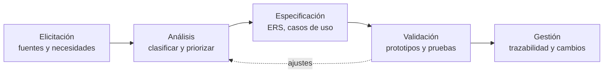

# 5. Ingeniería de requerimientos

Este documento describe **cómo** se obtuvieron, analizaron, especificaron y validaron los requisitos de Palo de Agua. El resultado (la lista de requisitos) está en la [Especificación de requisitos](06-especificacion-de-requisitos.md).

## 5.1 Proceso seguido

| Actividad | Qué se hizo | Resultado |
| --- | --- | --- |
| Elicitación | Análisis del caso de estudio (requerimientos 1 a 5) y del problema de la lluvia en Cali. | Necesidades NEC-01 a NEC-10 |
| Análisis | Se clasificaron en funcionales y no funcionales y se priorizaron con MoSCoW. | RF-01 a RF-18 y RNF-01 a RNF-11 |
| Especificación | Se redactaron como "El sistema deberá…" y se modelaron casos de uso. | [ERS](06-especificacion-de-requisitos.md) y [casos de uso](07-casos-de-uso.md) |
| Validación | Wireframe y mockup como prototipos, aplicación funcionando y pruebas automáticas. | [Plan de pruebas](09-plan-de-pruebas.md) |
| Gestión | Identificadores únicos, matriz de trazabilidad y control de cambios en Git. | [Trazabilidad](08-matriz-de-trazabilidad.md) |

## 5.2 Fuentes y técnicas de elicitación

| Fuente | Técnica | Qué aportó |
| --- | --- | --- |
| Caso de estudio («Req 1 a 5», citado en el wireframe) | Análisis documental | Ingreso, registro con cálculo, clave, ajuste del 5,3 %, gráfica y foto. |
| Contexto de Cali (aguaceros, estándar de 14 mm) | Análisis del dominio | Reglas del negocio y vocabulario. |
| Wireframe y mockup | Prototipado | Pantallas, textos, colores y el ejemplo numérico (22 mm → 486,5). |
| Equipo de desarrollo | Lluvia de ideas | Requisitos añadidos: validaciones, historial, CSV, zonas, accesibilidad. |

> **Limitación.** No se hicieron entrevistas con usuarios reales y el documento original del caso de estudio no está en el repositorio. Se recomienda guardarlo en `docs/fuentes/` y confirmar con el docente o la entidad los puntos de la sección 5.6.

## 5.3 Interesados (stakeholders)

| Interesado | Rol | Interés principal | Influencia |
| --- | --- | --- | --- |
| Registrador de campo | Usuario primario | Anotar rápido un aguacero y saber si pasó el estándar. | Alta |
| Supervisor / analista | Usuario secundario | Ver qué zonas superan los 14 mm y revisar la evidencia. | Alta |
| Entidad ambiental (se asume la CVC, por el usuario de acceso) | Cliente / dueña de las reglas | Cumplir el estándar y el ajuste horario. | Alta |
| Docente / evaluador | Revisor del caso de estudio | Que se cumplan los requerimientos 1 a 5. | Alta |
| Equipo de desarrollo | Constructor | Requisitos claros, probables y mantenibles. | Media |
| Comunidad de las zonas | Beneficiario indirecto | Que se detecten a tiempo las zonas con exceso de lluvia. | Baja |

## 5.4 De las necesidades a los requisitos

| Necesidad | Descripción | Requisitos funcionales |
| --- | --- | --- |
| NEC-01 | Que solo el personal autorizado use la aplicación. | RF-01, RF-02, RF-03 |
| NEC-02 | Registrar los datos de un aguacero. | RF-04, RF-05, RF-11 |
| NEC-03 | Saber si la lluvia pasó el estándar de Cali. | RF-06, RF-07 |
| NEC-04 | Aplicar el ajuste horario del 5,3 %. | RF-08 |
| NEC-05 | Esperar el cálculo sabiendo que la aplicación trabaja. | RF-09, RF-10 |
| NEC-06 | Controlar quién registra otra zona. | RF-12, RF-13 |
| NEC-07 | Ver todas las zonas de un vistazo. | RF-14 |
| NEC-08 | Dejar evidencia de la zona. | RF-15 |
| NEC-09 | Consultar lo registrado y sacarlo en un informe. | RF-16, RF-17, RF-18 |
| NEC-10 | Poder usarla en campo y no perder los datos. | RNF-02, RNF-05, RNF-09 |

## 5.5 Priorización (MoSCoW)

| Prioridad | Significado | Requisitos |
| --- | --- | --- |
| **M** (Must) | Sin esto el caso de estudio no se cumple | RF-01, 02, 04, 05, 06, 07, 08, 09, 11, 12, 13, 14, 15 |
| **S** (Should) | Importante, pero hay solución alterna | RF-03, 10, 16 |
| **C** (Could) | Deseable | RF-17, RF-18 |

## 5.6 Validación de la calidad de los requisitos

Cada requisito se revisó con los criterios de la norma ISO/IEC/IEEE 29148:

| Criterio | Se cumple | Observación |
| --- | --- | --- |
| Necesario | Sí | Cada RF viene de una necesidad (5.4). |
| Identificable y trazable | Sí | ID único; ver [matriz de trazabilidad](08-matriz-de-trazabilidad.md). |
| No ambiguo | Parcial | Ver pendientes abajo. |
| Verificable | Sí | Cada RF tiene un método y casos de prueba. |
| Consistente | Sí | No hay requisitos que se contradigan. |
| Completo | Parcial | Falta confirmar con el enunciado original. |

**Pendientes por confirmar con el interesado** (se tomó una decisión provisional en cada caso):

| # | Pendiente | Decisión provisional | Dónde se cambia |
| --- | --- | --- | --- |
| P-1 | Qué significa exactamente la cuenta `mm × 14 × horas = 462`. | Se implementó tal cual el mockup. | `js/calculo.js` |
| P-2 | Cuándo aplica el ajuste: ¿si el aguacero *empieza*, *termina* o *cruza* el horario de 3 a 6 p. m.? | Aplica si **inicia** entre 3:00 y 6:00 p. m. | `js/calculo.js` |
| P-3 | Valor de la clave de seguridad. | `AGUA1`. | `js/config.js` |
| P-4 | Duración del reloj de espera. | 2,8 s. | `js/config.js` |
| P-5 | Si el estándar se compara con los mm de lluvia o con el total calculado. | Con los mm de lluvia (`mm > 14`). | `js/calculo.js` |

## 5.7 Gestión de requisitos

- **Identificadores únicos:** NEC-, RF-, RNF-, RN-, HU-, CU-, CP-. No se reutilizan.
- **Trazabilidad:** necesidad → requisito → historia → caso de uso → módulo → prueba.
- **Control de cambios:** todo cambio se hace con un *commit* en Git y el mensaje explica qué requisito se modificó. Si cambia un requisito, se actualizan la ERS, la matriz y las pruebas.
- **Estados de un requisito:** Propuesto → Aprobado → Implementado → Verificado.
- **Línea base:** la versión 1.0 de la ERS corresponde a la entrega funcional de la aplicación.

## 5.8 Riesgos de los requisitos

| Riesgo | Efecto | Qué hacer |
| --- | --- | --- |
| Requisitos 1 a 5 interpretados distinto al enunciado | Retrabajo | Confirmar P-1 a P-5. |
| Credenciales escritas en el código | Acceso no seguro | Se documenta como limitación (RNF-06). |
| Un solo usuario compartido | No se sabe quién hizo qué | El campo «Quién registra» deja constancia. |
| Datos solo en el navegador | Se pierden si se borra el navegador | Exportar a CSV (RF-17). |
