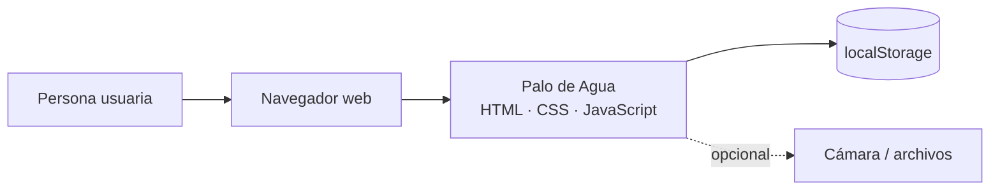

# 6. Especificación de requisitos de software (ERS)

Versión 1.0 · Estructura basada en ISO/IEC/IEEE 29148.

## 1. Introducción

### 1.1 Propósito
Definir los requisitos de **Palo de Agua**, una aplicación web para registrar y vigilar la lluvia por zonas de Cali. Va dirigida al equipo de desarrollo, al docente y a quien use o mantenga el sistema.

### 1.2 Alcance
La aplicación permite a personal autorizado registrar un aguacero (zona, horario y milímetros), compararlo con el estándar de Cali de 14 mm, aplicar el ajuste horario del 5,3 %, ver los registros en una gráfica de barras y dejar una foto de la zona.

**No incluye:** servidor ni base de datos central, sensores automáticos, alertas por correo o mensaje, aplicación móvil nativa, ni usuarios con roles distintos.

### 1.3 Definiciones y abreviaturas

| Término | Significado |
| --- | --- |
| Palo de agua | Aguacero fuerte (colombianismo). Da nombre al proyecto. |
| Estándar de Cali | Límite de precipitación de **14 mm**. |
| mm | Milímetros de lluvia. |
| Aguacero / registro | Un evento de lluvia anotado en la aplicación. |
| Zona | Sector de Cali donde cayó la lluvia (Pance, Siloé, Jamundí, Aguablanca, Granada u otra). |
| Ajuste | Aumento del 5,3 % para lluvias que inician entre 3:00 y 6:00 p. m. |
| Clave de seguridad | Código de 5 caracteres que se pide para registrar otra zona. |
| CVC | Usuario de acceso; en Cali, la CVC es la autoridad ambiental regional. |
| ERS | Especificación de requisitos de software. |
| RF / RNF / RN | Requisito funcional / no funcional / regla del negocio. |

### 1.4 Referencias
- [Contexto del problema](01-contexto-del-problema.md), [Componentes](02-componentes-del-desarrollo.md), [Historias de usuario](03-historias-de-usuario.md), [Backlog](04-backlog.md).
- `diseno/wireframe.html` y `diseno/mockup.html`.
- ISO/IEC/IEEE 29148:2018 (guía de estructura).

## 2. Descripción general

### 2.1 Perspectiva del producto
Aplicación independiente que corre completa en el navegador. No se conecta a otros sistemas. Guarda los datos en el propio navegador (`localStorage`).

### 2.2 Funciones principales
Ingreso · Registro de aguacero · Cálculo frente al estándar y ajuste · Reloj de espera · Clave de seguridad · Gráfica por zona · Foto · Historial · Exportación.

### 2.3 Características de los usuarios

| Usuario | Conocimiento técnico | Entorno de uso |
| --- | --- | --- |
| Registrador de campo | Básico | Celular, en exteriores |
| Supervisor / analista | Medio | Computador, en oficina |

### 2.4 Restricciones
- Debe construirse con **HTML, CSS y JavaScript** (sin servidor).
- Los datos se guardan en el navegador; `localStorage` ofrece unos 5 MB, por eso las fotos se reducen a 800 px.
- El diseño debe seguir el wireframe y el mockup.

### 2.5 Supuestos y dependencias
- La persona usa un navegador actual con JavaScript activo.
- Un único usuario compartido (`CVC`); no hay gestión de usuarios.
- Las preguntas abiertas P-1 a P-5 de la [ingeniería de requerimientos](05-ingenieria-de-requerimientos.md) tienen una decisión provisional.

## 3. Requisitos específicos

### 3.1 Interfaces externas

| Tipo | Descripción |
| --- | --- |
| Usuario | Tres pantallas: ingreso, panel principal y clave de seguridad, con el estilo «libreta de campo» (papel milimetrado). |
| Hardware | Cámara del dispositivo (opcional) para la foto. |
| Software | Navegador web actual. Fuentes Alfa Slab One y Karla de Google Fonts (con respaldo). |
| Comunicaciones | Ninguna: no se envían datos a ningún servidor. |

### 3.2 Requisitos funcionales

**Prioridad:** M = debe, S = debería, C = podría. **Verificación:** T = prueba, D = demostración, I = inspección. **Origen:** «Caso» = caso de estudio (Req 1 a 5); «Equipo» = añadido por el equipo.

#### Acceso

| ID | El sistema deberá… | Prior. | Origen | Verif. |
| --- | --- | --- | --- | --- |
| RF-01 | Permitir el ingreso con el usuario `CVC` y la contraseña `Lluvias` (el usuario sin distinguir mayúsculas). | M | Caso · Req 1 | T |
| RF-02 | Mostrar un mensaje de error si faltan datos o si son incorrectos, sin abrir el panel. | M | Equipo | T |
| RF-03 | Permitir cerrar la sesión y volver al ingreso. | S | Equipo | T |

#### Registro y cálculo

| ID | El sistema deberá… | Prior. | Origen | Verif. |
| --- | --- | --- | --- | --- |
| RF-04 | Pedir dirección, zona, quién registra y precipitación en mm, y permitir **elegir** (sin escribir) la hora de inicio y la de fin en tres listas: hora (1 a 12), minutos (de 5 en 5) y a. m./p. m. | M | Caso · Req 2 | T |
| RF-05 | Validar los datos: campos obligatorios, hora de fin posterior a la de inicio, mm mayores que 0 y no más de 500. | M | Equipo | T |
| RF-06 | Comparar los mm con el estándar de 14 mm e indicar por cuánto lo pasa (o que no lo pasa). | M | Caso · Req 2 | T |
| RF-07 | Mostrar la cuenta `mm × 14 × horas = base`. | M | Caso · Req 2 | T |
| RF-08 | Sumar el 5,3 % a la base si el aguacero inicia desde las 3:00 p. m. y antes de las 6:00 p. m. | M | Caso · Req 4 | T |
| RF-09 | Mostrar un reloj que gira unos segundos antes de dar el resultado y evitar registros duplicados mientras tanto. | M | Caso · Req 2 | T, D |
| RF-10 | Dibujar en el reloj el tramo entre la hora de inicio y la de fin. | S | Equipo (mockup) | T, D |
| RF-11 | Guardar cada registro de forma que siga disponible al recargar la página. | M | Equipo | T |

#### Clave de seguridad

| ID | El sistema deberá… | Prior. | Origen | Verif. |
| --- | --- | --- | --- | --- |
| RF-12 | Bloquear el formulario después de guardar y pedir la clave para registrar otra zona. | M | Caso · Req 3 | T |
| RF-13 | Con clave correcta, limpiar el formulario y volver al panel; con clave incorrecta, mostrar una alerta y volver al ingreso. | M | Caso · Req 3 | T |

#### Visualización, evidencia y datos

| ID | El sistema deberá… | Prior. | Origen | Verif. |
| --- | --- | --- | --- | --- |
| RF-14 | Mostrar una gráfica de barras (hasta 8 registros) con la línea del estándar de 14 mm; barra naranja si pasa y azul si no. | M | Caso · Req 5 | T, D |
| RF-15 | Permitir tomar o subir una foto de la zona y asociarla al registro. | M | Caso · Req 5 | D |
| RF-16 | Listar los registros guardados, del más reciente al más antiguo. | S | Equipo | T |
| RF-17 | Exportar los registros a un archivo CSV. | C | Equipo | D |
| RF-18 | Permitir cargar datos de ejemplo y borrar todos los registros (con confirmación). | C | Equipo | T |

### 3.3 Requisitos no funcionales

| ID | Categoría (ISO 25010) | El sistema deberá… | Verif. |
| --- | --- | --- | --- |
| RNF-01 | Usabilidad | Permitir registrar un aguacero en menos de 2 minutos sin capacitación (meta, por medir con usuarios). | D |
| RNF-02 | Usabilidad / Portabilidad | Verse y funcionar en pantallas desde 360 px de ancho sin desplazamiento horizontal de la página. | D |
| RNF-03 | Compatibilidad | Funcionar en navegadores actuales (Chrome, Edge, Firefox, Safari). | D |
| RNF-04 | Eficiencia | Calcular al instante y cargar sin servidor; el reloj de espera dura 2,8 s. | D |
| RNF-05 | Fiabilidad | No perder registros al recargar; si `localStorage` falla, seguir funcionando en memoria y avisar. | T |
| RNF-06 | Seguridad | Limitar el acceso al personal autorizado. *Limitación:* las credenciales están en el código del cliente, por lo que no es seguro para uso real. | I |
| RNF-07 | Accesibilidad | Usar etiquetas en los campos, foco visible, mensajes anunciables (`role="alert"`, `aria-live`) y respetar «reducir movimiento». | I |
| RNF-08 | Mantenibilidad | Estar dividido en módulos con las reglas del negocio centralizadas en `js/config.js` y pruebas automáticas. | I |
| RNF-09 | Portabilidad | Abrirse con doble clic en `index.html`, sin instalar nada. | D |
| RNF-10 | Localización | Usar español de Colombia: coma decimal, hora de 12 h con «a. m./p. m.» y fecha dd/mm/aaaa. | I |
| RNF-11 | Privacidad | Mantener datos y fotos solo en el dispositivo de la persona. | I |

### 3.4 Reglas del negocio

| ID | Regla |
| --- | --- |
| RN-1 | El estándar de Cali es de 14 mm. |
| RN-2 | Si la lluvia supera el estándar, se informa por cuántos mm lo pasa. |
| RN-3 | Si el aguacero inicia entre las 3:00 p. m. y las 6:00 p. m., se aplica un ajuste del 5,3 %. |
| RN-4 | Para registrar otra zona después de guardar, se pide la clave de seguridad. |
| RN-5 | Si la clave no coincide, se vuelve al ingreso. |
| RN-6 | El acceso es solo para personal autorizado. |

### 3.5 Modelo de datos

Entidad **Registro** (se guarda como JSON en `localStorage`, clave `palo-de-agua:registros:v1`):

| Campo | Tipo | Regla |
| --- | --- | --- |
| `id` | texto | Único: marca de tiempo + zona. |
| `fecha` | texto ISO 8601 | Momento del registro. |
| `zona` | texto | Una de la lista de zonas. |
| `direccion` | texto | Mínimo 3 caracteres. |
| `horaInicio`, `horaFin` | texto `HH:MM` | Fin posterior a inicio. |
| `milimetros` | número | Mayor que 0 y hasta 500. |
| `registradoPor` | texto | Mínimo 2 caracteres. |
| `pasaEstandar` | booleano | `milimetros > 14`. |
| `excesoMm` | número | `max(0, milimetros − 14)`. |
| `ajusteAplicado` | booleano | RN-3. |
| `base`, `total` | número | `base = mm × 14 × horas`; `total = base × 1,053` si hay ajuste. |
| `foto` | texto (imagen en base64) o nulo | JPEG reducido a 800 px. |

## 4. Verificación y trazabilidad

La relación entre necesidades, requisitos, historias, casos de uso, módulos y pruebas está en la [matriz de trazabilidad](08-matriz-de-trazabilidad.md). Las pruebas están en el [plan de pruebas](09-plan-de-pruebas.md).
