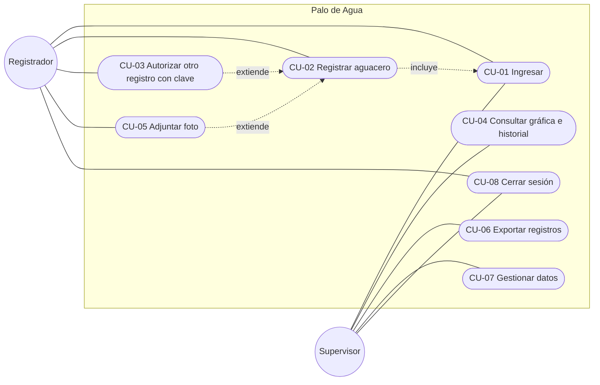
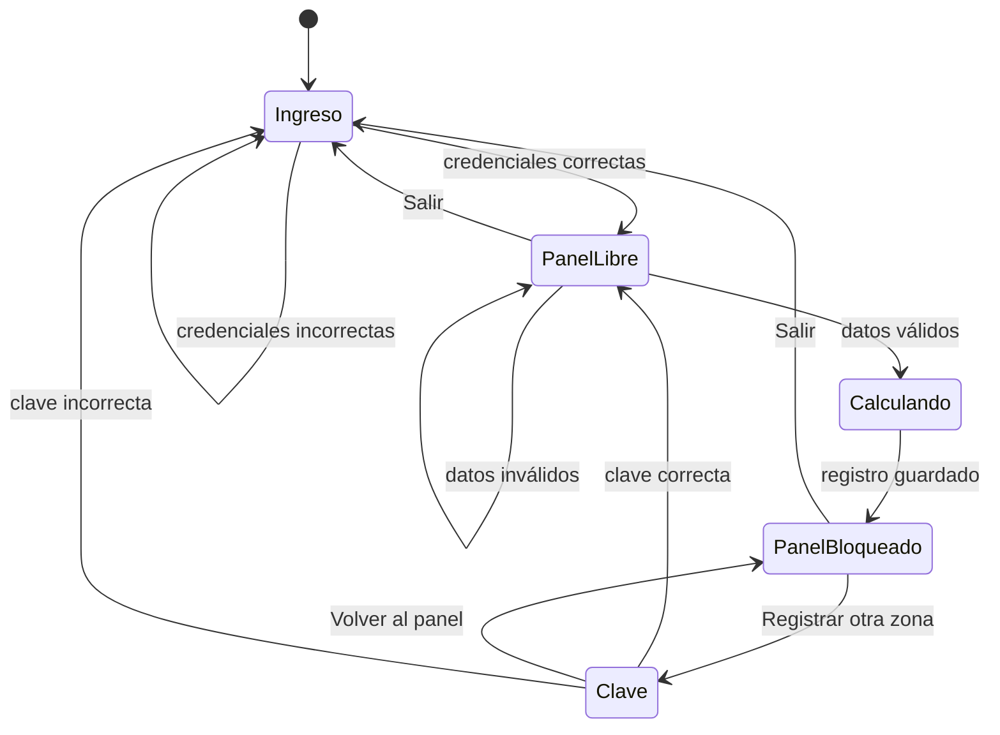

# 7. Casos de uso

## 7.1 Actores

| Actor | Descripción |
| --- | --- |
| Registrador | Personal de campo que anota los aguaceros. |
| Supervisor | Persona que revisa la gráfica y el historial. |

Ambos entran con el mismo usuario (`CVC`), porque el sistema tiene una sola cuenta. Se distinguen por lo que hacen.

## 7.2 Diagrama de casos de uso

## 7.3 Especificaciones

### CU-01 · Ingresar
| | |
| --- | --- |
| **Actores** | Registrador, Supervisor |
| **Requisitos** | RF-01, RF-02 · HU-01 |
| **Precondición** | La persona está en la pantalla de ingreso. |
| **Postcondición** | Se abre el panel principal y se muestra el usuario de la sesión. |

**Flujo principal**
1. La persona escribe usuario y contraseña.
2. Pulsa *Ingresar*.
3. El sistema valida las credenciales.
4. El sistema muestra el panel principal.

**Flujos alternos**
- 3a. Faltan datos: el sistema muestra «Escribe el usuario y la contraseña.»
- 3b. Credenciales incorrectas: el sistema muestra «Usuario o contraseña incorrectos.», limpia la contraseña y se queda en el ingreso.

### CU-02 · Registrar aguacero
| | |
| --- | --- |
| **Actor** | Registrador |
| **Requisitos** | RF-04 a RF-11 · HU-02 a HU-05, HU-10, HU-11 |
| **Precondición** | Sesión iniciada y formulario libre. |
| **Postcondición** | El registro queda guardado, con resultado visible y barra nueva en la gráfica. El formulario queda bloqueado. |

**Flujo principal**
1. El registrador llena dirección, zona, quién registra y milímetros, y elige las horas de inicio y de fin en las listas (hora, minutos y a. m./p. m.).
2. Pulsa *Calcular y registrar*.
3. El sistema valida los datos.
4. El sistema muestra el reloj girando durante 2,8 s.
5. El sistema calcula `mm × 14 × horas` y aplica el ajuste si corresponde.
6. El sistema compara los mm con el estándar de 14 mm.
7. El sistema guarda el registro, muestra el resultado, dibuja el tramo en el reloj y actualiza la gráfica y el historial.
8. El sistema bloquea el formulario y cambia el botón a *Registrar otra zona*.

**Flujos alternos**
- 3a. Hay datos inválidos: el sistema marca cada campo con su mensaje y no continúa.
- 4a. La persona vuelve a pulsar durante la espera: se ignora (no se duplica el registro).
- 7a. El navegador no puede guardar: el sistema avisa que el registro se calculó pero no se guardó.

### CU-03 · Autorizar otro registro con clave
| | |
| --- | --- |
| **Actor** | Registrador |
| **Requisitos** | RF-12, RF-13 · HU-06 |
| **Precondición** | Hay un registro guardado y el formulario está bloqueado. |
| **Postcondición** | Formulario limpio (clave correcta) o sesión cerrada (clave incorrecta). |

**Flujo principal**
1. El registrador pulsa *Registrar otra zona*.
2. El sistema muestra la pantalla de clave con 5 casillas.
3. El registrador escribe la clave y pulsa *Continuar*.
4. El sistema valida la clave y vuelve al panel con los campos limpios.

**Flujos alternos**
- 3a. La clave está incompleta: el sistema pide escribir los 5 caracteres.
- 3b. La clave es incorrecta: el sistema muestra una alerta, cierra la sesión y vuelve al ingreso.
- 3c. El registrador pulsa *Volver al panel*: regresa sin desbloquear el formulario.

### CU-04 · Consultar gráfica e historial
| | |
| --- | --- |
| **Actor** | Supervisor |
| **Requisitos** | RF-14, RF-16 · HU-07, HU-13 |
| **Precondición** | Sesión iniciada. |
| **Postcondición** | Ninguna (solo lectura). |

**Flujo principal**
1. El supervisor abre el panel.
2. El sistema dibuja la gráfica con los últimos 8 registros, la línea del estándar y los colores naranja o azul.
3. El sistema lista el historial, del más reciente al más antiguo.

**Flujo alterno**
- 2a. No hay registros: la gráfica indica «Aún no hay registros» y el historial muestra «Todavía no hay registros.»

### CU-05 · Adjuntar foto
| | |
| --- | --- |
| **Actor** | Registrador |
| **Requisitos** | RF-15 · HU-08 |
| **Precondición** | Sesión iniciada. |
| **Postcondición** | La foto queda asociada al registro (el actual o el que se guarde a continuación). |

**Flujo principal**
1. El registrador pulsa *Tomar foto de la zona*.
2. El dispositivo abre la cámara o el selector de archivos.
3. El registrador elige la imagen.
4. El sistema la reduce, la muestra como vista previa y la asocia al registro.

**Flujos alternos**
- 3a. El archivo no es una imagen: el sistema avisa.
- 4a. El almacenamiento está lleno: el sistema guarda el registro sin la foto y avisa.

### CU-06 · Exportar registros
| | |
| --- | --- |
| **Actor** | Supervisor |
| **Requisitos** | RF-17 · HU-14 |
| **Postcondición** | Se descarga `palo-de-agua-registros.csv`. |

**Flujo principal:** el supervisor pulsa *Exportar CSV* y el sistema descarga el archivo.
**Flujo alterno:** si no hay registros, el sistema avisa que no hay nada para exportar.

### CU-07 · Gestionar datos
| | |
| --- | --- |
| **Actor** | Supervisor |
| **Requisitos** | RF-18 |

**Flujo principal:** el supervisor pulsa *Cargar ejemplo* y se agregan 5 registros de muestra.
**Flujo alterno (borrar):** pulsa *Borrar registros*, el botón pide confirmar («¿Seguro? Pulsa otra vez»); si pulsa de nuevo en 4 s se borra todo; si no, se cancela.

### CU-08 · Cerrar sesión
| | |
| --- | --- |
| **Actores** | Registrador, Supervisor |
| **Requisitos** | RF-03 · HU-09 |

**Flujo principal:** la persona pulsa *Salir* y el sistema cierra la sesión y muestra el ingreso.

## 7.4 Estados de la interfaz

