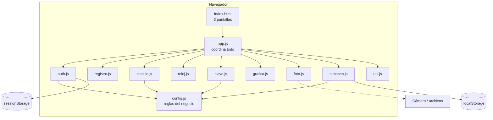
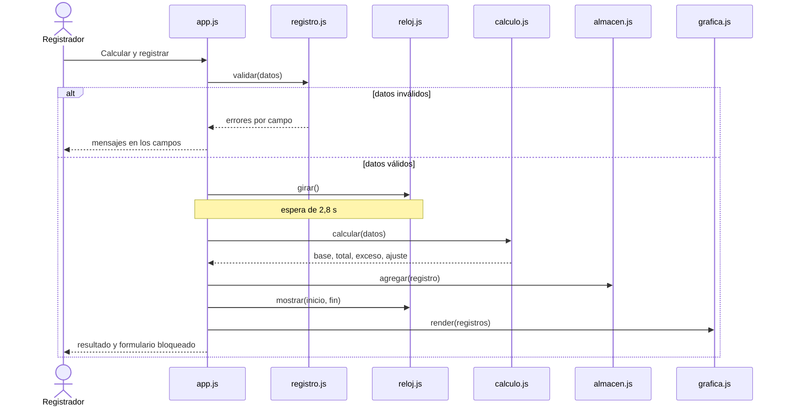
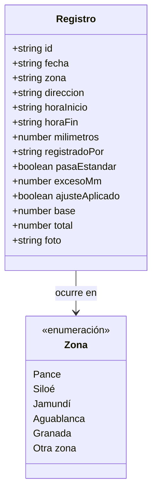

# 10. Arquitectura y diseño

## 10.1 Vista general

La aplicación corre completa en el navegador. No tiene servidor.

**Decisiones de diseño**

| Decisión | Motivo |
| --- | --- |
| Scripts clásicos (no módulos ES) | Permiten abrir `index.html` con doble clic; los módulos ES no funcionan desde `file://`. |
| Reglas del negocio en `config.js` | Cambiar el estándar, el ajuste o la clave no exige tocar la lógica. |
| `calculo.js` sin acceso al DOM | Se puede probar con Node sin navegador. |
| Gráfica en SVG generado por código | Escala sin perder nitidez y respeta el estilo de papel milimetrado. |
| Fotos reducidas a 800 px (JPEG 72 %) | Caben en el límite de `localStorage` (unos 5 MB). |
| Cámara con `getUserMedia` y un botón aparte para subir | Funciona igual en computador y celular, con vista previa; si la cámara falla, «Subir foto» siempre está disponible. |
| Apagar la cámara al capturar, cancelar o cerrar | Respeta la privacidad y libera la cámara. |
| Alerta y confirmación propias (no `alert()` ni `confirm()`) | Funcionan en todos los entornos y se pueden estilizar. |
| Sesión en `sessionStorage` | La sesión termina al cerrar la pestaña. |

## 10.2 Responsabilidades de cada módulo

| Módulo | Responsabilidad | Requisitos |
| --- | --- | --- |
| `config.js` | Constantes: usuario, claves, 14 mm, 5,3 %, horario, zonas. | RN-1 a RN-6 |
| `util.js` | Formato de números, horas y fechas. | RNF-10 |
| `calculo.js` | `calcular()`: base, ajuste, total, exceso. | RF-06, RF-07, RF-08 |
| `registro.js` | `validar()`: reglas de cada campo. | RF-05 |
| `auth.js` | Validar ingreso y manejar la sesión. | RF-01, RF-03 |
| `reloj.js` | Girar, mostrar el tramo, volver a reposo. | RF-09, RF-10 |
| `clave.js` | 5 casillas con avance automático y validación. | RF-13 |
| `grafica.js` | Dibujar el SVG de barras y la línea del estándar. | RF-14 |
| `foto.js` | Abrir la cámara (`getUserMedia`), capturar, girar, subir una imagen, reducirla y avisar si la cámara no está disponible. | RF-15, RF-19, RF-20 |
| `almacen.js` | Leer, agregar, actualizar y borrar registros. | RF-11, RF-18 |
| `app.js` | Conectar eventos, pantallas, historial y CSV. | RF-02, RF-12, RF-16, RF-17 |

## 10.3 Secuencia: registrar un aguacero

## 10.4 Modelo de datos

## 10.5 Diseño de la interfaz

| Elemento | Decisión |
| --- | --- |
| Estilo | «Libreta de campo»: papel milimetrado, bordes de tinta y sombra desplazada. |
| Paleta | Noche `#10262F` · Guadua `#2E7D5B` · Aguacero `#3FA7C8` · Chontaduro `#F28C28` · Neblina `#EAF2F0` |
| Tipografías | Alfa Slab One (títulos) y Karla (texto). |
| Significado del color | Naranja = pasa el estándar; azul = dentro del estándar. |
| Prototipos | `diseno/wireframe.html`, `diseno/mockup.html` y el archivo de Figma «Palo de Agua · Wireframe y Mockup». |
